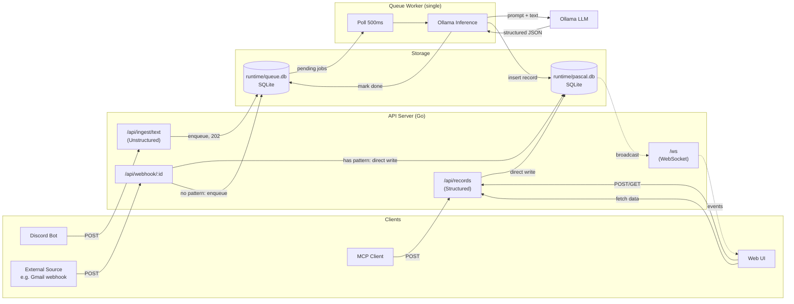

# PASCAL — Architecture Analysis

## 1. Scope & Constraints

Single-user, local-network only. No auth needed (trusted network). Ollama dependency means the host machine needs decent RAM (8GB+ for small models).

### Database Choice: SQLite (primary) + DuckDB (analytics enhancement)

**Primary: SQLite** — zero-ops, single file, embedded. Handles all writes (single-row inserts, ~10-100/day) and serves as source of truth. WAL mode handles concurrent reads during writes.

**Enhancement: DuckDB** — columnar, embedded, same operational simplicity as SQLite (single file, no server). All 4 dashboard use cases (COUNT, SUM, MIN/MAX, AVG over time with GROUP BY) are aggregation-heavy — column store territory. DuckDB runs these 10-100x faster at scale.

**How they work together:**
- All writes go to SQLite (fast single-row inserts, audit log, CRUD operations)
- Dashboard/stats queries go through DuckDB, which can read SQLite files directly via its SQLite scanner:
  ```sql
  ATTACH 'runtime/pascal.db' AS pascal (TYPE sqlite);
  SELECT rt.scope_path, COUNT(DISTINCT r.id), AVG(rv.v)
  FROM pascal.record r
  JOIN pascal.record_tags rt ON r.id = rt.record_id
  JOIN pascal.record_values rv ON r.id = rv.id
  WHERE rt.scope_path IS NOT NULL
  GROUP BY rt.scope_path;
  ```
- No ETL or sync needed — DuckDB queries SQLite in-place
- Can optionally export to `.parquet` later if dataset grows large

**When to introduce DuckDB:** Not day one. Start with SQLite for everything. Add DuckDB when dashboard queries feel slow or when you want richer analytics (window functions, percentiles, time-bucket aggregations). The migration path is zero-effort since DuckDB reads SQLite natively.

## 2. Schema Review

### What works

- Short field names — fine for SQLite, saves storage on high-volume logs.
- `RecordLog` as audit trail — good. Status transitions are first-class.
- `MasterValue` as a registry — extensible without schema changes.
- `Recipe` as templates — solid pattern for repeated workflows.
- Hierarchical tags via self-referential FK — simple, covers the "Project > Epic > Sub Task" tree.

### Issues & Recommendations

#### 2.1 Scope hierarchy — multi-dimensional via tags

**Decision:** Scopes are defined in a `scope` master table with parent hierarchy. Tags reference scopes via `tag.s` FK. Records inherit scope dimensions through their tags — no single `record.sc` field.

**How it works:**
- `scope` table defines hierarchy: e.g. Finance → payment-source, Finance → category
- Tags belong to scopes: e.g. tag "grab" has `s = 3` (scope "payment-source" under "Finance")
- Tags sharing a scope are **exclusive** per record (one tag per scope per record)
- `record_tags.scope_path` stores denormalized materialized path at insert time (e.g. "Finance|payment-source")
- Multi-dimensional grouping: a record with tags from different scopes can be grouped by any dimension via `GROUP BY scope_path`
- Scope filter uses `scope_path LIKE 'Finance|%'` — fast prefix query via index

**Recipe enforcement:** `recipe_scopes` defines required scopes per recipe. On record creation, system validates that extracted tags cover all required scopes.

```sql
CREATE TABLE scope (
    id INTEGER PRIMARY KEY AUTOINCREMENT,
    name TEXT NOT NULL,
    parent_id INTEGER REFERENCES scope(id),
    UNIQUE(name, parent_id)
);

CREATE TABLE recipe_scopes (
    recipe_u TEXT NOT NULL REFERENCES recipe(u) ON DELETE CASCADE,
    scope_id INTEGER NOT NULL REFERENCES scope(id),
    required INTEGER NOT NULL DEFAULT 1,
    PRIMARY KEY (recipe_u, scope_id)
);
```

#### 2.2 Tags → scope-based junction table

**Decision:** Tags reference scopes (not self-referential). Junction table `record_tags` carries denormalized `scope_path`.

```sql
CREATE TABLE tag (
    t TEXT PRIMARY KEY,
    s INTEGER REFERENCES scope(id), -- scope group
    d TEXT NOT NULL
);

CREATE TABLE record_tags (
    record_id BLOB NOT NULL REFERENCES record(id) ON DELETE CASCADE,
    tag TEXT NOT NULL REFERENCES tag(t),
    scope_path TEXT,                -- materialized path from tag's scope ancestry
    PRIMARY KEY (record_id, tag)
);
CREATE INDEX idx_record_tags_tag ON record_tags(tag);
CREATE INDEX idx_record_tags_scope_path ON record_tags(scope_path);
```

#### 2.3 `Record.r` (recipe) → nullable FK

**Decision:** Explicit nullable FK to `recipe(u)`. NULL = no recipe, not empty string.

#### 2.4 `Record.id` — UUIDv7

**Decision:** UUIDv7 as `BLOB(16)`. Time-ordered (B-tree stays sequential), 56% smaller than TEXT(36), faster comparisons.

#### 2.5 Deletion strategy → cascade delete

**Decision:** No soft delete. Use `ON DELETE CASCADE` on RecordLog, RecordValues, record_tags. Simple, no query overhead. Audit trail dies with record — acceptable for personal use.

#### 2.6 `RecordValues` timestamp → skip

**Decision:** Values are immutable (set once at record creation). No timestamp needed.

#### 2.7 `Record.due` — due date for deadlines

**Decision:** Add `due TEXT` (ISO 8601, nullable) to record table. Enables meeting prep use case: questions scoped under `Meetings|<name>` with `due` set to meeting start time. Also useful for any time-bound task. Overdue query: `WHERE st < 3 AND due < datetime('now')`. Indexed.

#### 2.8 Recipe mappings → `recipe_values` + `recipe_scopes`

**Decision:** Separate tables. `recipe_values` maps required/optional value types. `recipe_scopes` maps required scope groups (must have a tag from each). MCP/worker reads these to validate extracted data.

```sql
CREATE TABLE recipe_values (
    recipe_u TEXT NOT NULL REFERENCES recipe(u) ON DELETE CASCADE,
    master_key TEXT NOT NULL REFERENCES master_value(k),
    required INTEGER NOT NULL DEFAULT 1,
    PRIMARY KEY (recipe_u, master_key)
);

CREATE TABLE recipe_scopes (
    recipe_u TEXT NOT NULL REFERENCES recipe(u) ON DELETE CASCADE,
    scope_id INTEGER NOT NULL REFERENCES scope(id),
    required INTEGER NOT NULL DEFAULT 1,
    PRIMARY KEY (recipe_u, scope_id)
);
```

MCP reads these tables to know: "for recipe X, which values must be provided and which scope groups need a tag?"

## 3. Component Architecture



**Three paths:**
- **Structured** (MCP, Web UI) → validate → write directly to `runtime/pascal.db`
- **Unstructured** (Discord bot, other bots) → enqueue in `runtime/queue.db` → 202 instant → worker picks up → Ollama infers → write to `runtime/pascal.db` → WS broadcast
- **Webhook** (external sources: Gmail, bank alerts) → if has pattern: regex extract → direct write; if no pattern: queue to Ollama (optionally with recipe context)

### 3.1 Tech Stack Decision

**Go + stdlib.** Single binary, deploy-and-forget daemon. Go 1 compatibility promise = no surprise breakage.

| Component | Library | Why |
|---|---|---|
| HTTP/Router | `net/http` + `chi` | stdlib mux is fine; chi adds middleware chaining if needed |
| SQLite | `modernc.org/sqlite` | Pure Go, no CGO, cross-compile works |
| WebSocket | `nhooyr.io/websocket` | Clean API, context-aware, stdlib compatible |
| Discord bot | `discordgo` | Mature, well-maintained |
| Ollama client | `net/http` | Just POST JSON to `localhost:11434`, no lib needed |
| Config | `envconfig` or `os.Getenv` | Keep it simple |
| Migrations | Raw SQL files + version table | No ORM, no framework |
| Frontend | Pure HTML/JS/CSS | Served as embedded static files via `embed` |

### 3.2 API Design

Two ingestion paths converge to one write path:

```
Unstructured text ──▶ Ollama inference ──▶ Structured record ──▶ DB write
Structured payload ─────────────────────▶ Structured record ──▶ DB write
```

Key endpoints:

| Method | Path | Purpose |
|--------|------|---------|
| POST | `/api/ingest/text` | Unstructured text → Ollama → record |
| POST | `/api/records` | Create structured record |
| PATCH | `/api/records/:id` | Update record (status change → RecordLog) |
| GET | `/api/records` | Query with filters (tags, scope, date range) |
| GET | `/api/stats` | Aggregations (count/sum/min/max/avg by dimension) |
| GET | `/api/tags` | Tag tree |
| GET | `/api/recipes` | List recipes |
| WS | `/ws` | Real-time dashboard updates |

### 3.3 Discord Bot

Should be a separate process that calls the ingestion API — not embedded in the server. Reasons:
- Bot token lifecycle independent of server
- Bot crash doesn't take down API
- Can restart bot without disrupting dashboard WebSocket connections

Communication: Bot receives `@pascal` mention → POST `/api/ingest/text` → respond with confirmation in Discord.

### 3.4 WebSocket Strategy

Don't push full query results over WS. Instead:

1. Server emits lightweight events: `{ type: "record:created", id: "..." }`
2. Dashboard client receives event, fetches updated data via REST
3. Keeps WS payloads small, avoids duplicating query logic in WS handler

Alternative: if dashboard is simple enough, push the denormalized record directly. Decide based on dashboard complexity.

### 3.5 Ingestion System

Full ingestion design — queue, webhooks, Google Calendar sync — in **[ingestion.md](ingestion.md)**.

**Key decisions documented there:**
- SQLite-backed queue in separate file (`runtime/queue.db`) — ephemeral, no WAL contention, `rm` to reset
- Single worker goroutine, 500ms poll, 3 retries, backpressure at 1000
- Webhook as independent entity from recipe (many webhooks can share one recipe)
- Three webhook modes: pattern (regex), field_map (JSONPath), or Ollama fallback
- Google Calendar push sync — separate from generic webhooks (headers-only payload, needs API callback, OAuth, watch renewal)
- Network split: webhook + gcal push endpoints public (VPS), everything else Tailscale only

## 4. Query Patterns vs Schema Fitness

README lists four use cases. Checking each:

| Use Case | Query Pattern | Schema Support | Notes |
|----------|--------------|----------------|-------|
| Count events over time | `SELECT COUNT(*) ... GROUP BY strftime(ct)` | ✅ Good | Index on `ct` |
| Aggregate values over time | `SELECT SUM(v) FROM record_values JOIN record ...` | ✅ Good | Composite index `(id, k)` |
| Filter aggregates by tags | `JOIN record_tags WHERE tag = ?` | ✅ Good | Junction table with index |
| Multi-dimensional grouping | `GROUP BY record_tags.scope_path` | ✅ Good | Scope path index, `COUNT(DISTINCT r.id)` avoids dupes |

**Critical indexes:**
- `record(ct)` — time-range queries
- `record(st)` — status filtering
- `record_tags(tag)` — tag filtering
- `record_tags(scope_path)` — scope grouping and prefix matching
- `record_values(id, k)` — value lookups per record
- `record_log(id, at)` — audit trail per record

## 5. Migration Strategy

SQLite schema changes are painful (no `ALTER COLUMN`, limited `DROP COLUMN`). Plan for this:

- Raw SQL migration files (`migrations/001_init.sql`, `002_add_scope.sql`, etc.)
- `_migrations` table tracks applied versions
- Run migrations on startup via Go `embed` — embed `migrations/*.sql`, apply in order
- Never hand-edit production `.db` file

## 6. Risk Assessment

| Risk | Impact | Mitigation |
|------|--------|------------|
| Ollama down/slow | Unstructured ingestion fails | Graceful fallback: queue text, retry later |
| SQLite write contention | WebSocket + API writes conflict | WAL mode (default in modern SQLite), single writer pattern |
| Schema painted into corner | Expensive migration | Junction tables now, migration tooling from start |
| Discord bot token leak | Bot compromise | `.env` file, never commit, restrict bot permissions |
| DB file corruption | Data loss | Daily backup cron (just `cp` the `.db` file, SQLite is single-file) |

## 7. Recommended Project Structure

```
pascal/
├── cmd/
│   ├── server/main.go       # API server + queue worker entrypoint
│   └── bot/main.go          # Discord bot (separate binary)
├── internal/
│   ├── db/
│   │   ├── db.go            # Open, migrate, WAL setup
│   │   ├── record.go        # Record CRUD queries
│   │   ├── stats.go         # Aggregation queries
│   │   └── queue.go         # Queue DB operations
│   ├── api/
│   │   ├── router.go        # Route definitions
│   │   ├── records.go       # Record handlers
│   │   ├── stats.go         # Stats handlers
│   │   └── ingest.go        # Ingestion handlers (structured + unstructured)
│   ├── worker/
│   │   └── worker.go        # Queue poller + Ollama inference
│   ├── ollama/
│   │   └── client.go        # Ollama HTTP client
│   └── ws/
│       └── hub.go           # WebSocket hub + broadcast
├── migrations/
│   └── 001_init.sql         # Embedded via go:embed
├── web/
│   ├── index.html           # Embedded via go:embed
│   ├── app.js
│   └── style.css
├── runtime/                  # Data files (gitignored)
│   ├── pascal.db             # Main data
│   └── queue.db              # Ingestion queue
├── .env                      # Secrets (gitignored)
├── go.mod
└── Makefile
```

Two binaries: `cmd/server` (API + worker as goroutine) and `cmd/bot` (Discord daemon). Static files and migrations embedded in binary via `go:embed` — single file deployment.

## 8. What to Build First

Priority order based on dependency chain:

1. **DB schema + migrations** — everything depends on this
2. **Structured ingestion API** — core CRUD, validates the schema works
3. **Query/stats endpoints** — validates the schema supports all 4 use cases
4. **Web dashboard** — visualize what you've built
5. **Ollama integration** — unstructured ingestion
6. **Discord bot** — convenience layer on top of working API
7. **WebSocket** — real-time is nice-to-have after core works
