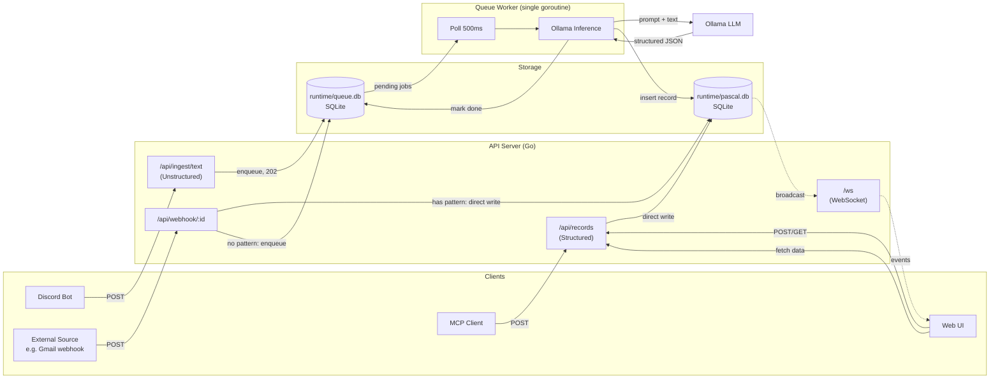

# PASCAL — Design Specification

## Overview

PASCAL (Personal Assistant for Statistics, Context, Actions & Logging) is a local-network server for personal event logging, statistics aggregation, and dashboards. Single-user, no auth.

## Tech Stack

| Layer | Choice |
|---|---|
| Language | Go |
| HTTP/Router | `net/http` + `chi` |
| SQLite | `modernc.org/sqlite` (pure Go, no CGO) |
| WebSocket | `nhooyr.io/websocket` |
| Discord | `discordgo` |
| Ollama | `net/http` (raw HTTP to `localhost:11434`) |
| Frontend | Pure HTML/JS/CSS, embedded via `go:embed` |
| Migrations | Raw SQL files, embedded via `go:embed` |

## Architecture



### Ingestion

Three paths: Structured (direct write), Generic Webhook (pattern extract or Ollama queue), Google Calendar (push sync). See **[ingestion.md](ingestion.md)** for full design.

### Discord Bot

Separate binary (`cmd/bot`). Calls ingestion API over HTTP. Independent lifecycle from server — bot crash doesn't affect API or dashboard.

### WebSocket

Lightweight event notification: `{ "type": "record:created", "id": "..." }`. Client fetches updated data via REST. No query logic in WS handler.

## Database

### Storage Files

| File | Purpose | Lifecycle |
|---|---|---|
| `runtime/pascal.db` | All application data | Permanent, backed up |
| `runtime/queue.db` | Ingestion queue | Ephemeral, can `rm` safely |

Both use WAL mode. Separate files avoid WAL contention between high-churn queue writes and steady application writes.

### Schema

```sql
-- Scope hierarchy (tag grouping + multi-dimensional queries)
CREATE TABLE scope (
    id INTEGER PRIMARY KEY AUTOINCREMENT,
    name TEXT NOT NULL,
    parent_id INTEGER REFERENCES scope(id),
    UNIQUE(name, parent_id)
);

-- Tag definitions (scope-based exclusivity)
CREATE TABLE tag (
    t TEXT PRIMARY KEY,
    s INTEGER REFERENCES scope(id), -- scope (tags sharing a scope are exclusive per record)
    d TEXT NOT NULL                  -- description
);

-- Value type registry (THB, TOKEN, etc.)
CREATE TABLE master_value (
    k TEXT PRIMARY KEY,             -- key
    d TEXT NOT NULL                  -- description
);

-- Recipe templates
CREATE TABLE recipe (
    u TEXT PRIMARY KEY,             -- usecase key
    d TEXT NOT NULL,                 -- description
    default_st INTEGER NOT NULL DEFAULT 1  -- default status for records (0=paused,1=todo,2=doing,3=done)
);

-- Recipe ↔ MasterValue mapping (for MCP interpretation)
CREATE TABLE recipe_values (
    recipe_u TEXT NOT NULL REFERENCES recipe(u) ON DELETE CASCADE,
    master_key TEXT NOT NULL REFERENCES master_value(k),
    required INTEGER NOT NULL DEFAULT 1,  -- 1=required, 0=optional
    PRIMARY KEY (recipe_u, master_key)
);

-- Recipe ↔ Scope mapping (required scopes per recipe)
CREATE TABLE recipe_scopes (
    recipe_u TEXT NOT NULL REFERENCES recipe(u) ON DELETE CASCADE,
    scope_id INTEGER NOT NULL REFERENCES scope(id),
    required INTEGER NOT NULL DEFAULT 1,
    PRIMARY KEY (recipe_u, scope_id)
);

-- Webhook endpoints (see ingestion.md for processing modes)
CREATE TABLE webhook (
    id TEXT PRIMARY KEY,                        -- slug, used in URL: /api/webhook/:id
    d TEXT NOT NULL,                             -- description
    secret TEXT NOT NULL,                        -- auth token (X-Webhook-Secret header)
    pattern TEXT,                                -- regex with named groups (text payloads)
    field_map TEXT,                              -- JSON: JSONPath mappings (JSON payloads)
    recipe_u TEXT REFERENCES recipe(u),          -- optional recipe binding
    active INTEGER NOT NULL DEFAULT 1
);

-- Google Calendar sync config (see ingestion.md for push flow)
CREATE TABLE gcal_sync (
    id TEXT PRIMARY KEY,
    calendar_id TEXT NOT NULL,                   -- Google Calendar ID
    channel_id TEXT,                             -- watch channel ID
    channel_token TEXT,                          -- verification token
    resource_id TEXT,                            -- Google resource ID
    expiration TEXT,                             -- watch expiration (needs renewal)
    scope TEXT NOT NULL,                         -- default scope for synced records
    category TEXT NOT NULL,                      -- default category
    recipe_u TEXT REFERENCES recipe(u),
    active INTEGER NOT NULL DEFAULT 1
);

-- Main record
CREATE TABLE record (
    id BLOB PRIMARY KEY,            -- UUIDv7, 16 bytes
    tl TEXT NOT NULL,               -- title
    dt TEXT,                        -- detail
    st INTEGER NOT NULL DEFAULT 1,  -- 0=paused, 1=todo, 2=doing, 3=done
    ct TEXT NOT NULL DEFAULT (datetime('now')),  -- created at
    r TEXT REFERENCES recipe(u)     -- recipe (nullable FK)
);

-- Record ↔ Tag junction (scope_path = materialized path from tag's scope ancestry)
CREATE TABLE record_tags (
    record_id BLOB NOT NULL REFERENCES record(id) ON DELETE CASCADE,
    tag TEXT NOT NULL REFERENCES tag(t),
    scope_path TEXT,                -- e.g. "Finance|payment-source", NULL for unscoped tags
    PRIMARY KEY (record_id, tag)
);

-- Aggregatable values per record (immutable, set once)
CREATE TABLE record_values (
    id BLOB NOT NULL REFERENCES record(id) ON DELETE CASCADE,
    k TEXT NOT NULL REFERENCES master_value(k),
    v REAL NOT NULL,
    PRIMARY KEY (id, k)
);

-- Status change audit log
CREATE TABLE record_log (
    id BLOB NOT NULL REFERENCES record(id) ON DELETE CASCADE,
    sst INTEGER NOT NULL,           -- switched status to
    inf TEXT NOT NULL DEFAULT '',    -- additional info
    at TEXT NOT NULL DEFAULT (datetime('now'))
);

-- Indexes
CREATE INDEX idx_scope_parent ON scope(parent_id);
CREATE INDEX idx_record_ct ON record(ct);
CREATE INDEX idx_record_st ON record(st);
CREATE INDEX idx_record_tags_tag ON record_tags(tag);
CREATE INDEX idx_record_tags_scope_path ON record_tags(scope_path);
CREATE INDEX idx_record_values_k ON record_values(id, k);
CREATE INDEX idx_record_log_id_at ON record_log(id, at);
```

### Queue Schema (runtime/queue.db)

```sql
CREATE TABLE ingest_queue (
    id INTEGER PRIMARY KEY AUTOINCREMENT,
    payload TEXT NOT NULL,
    source TEXT NOT NULL,                       -- 'discord', 'webhook:cc_kbank', 'api', etc.
    recipe_hint TEXT,                            -- optional recipe_u for Ollama context
    status TEXT NOT NULL DEFAULT 'pending',      -- pending | processing | done | failed
    attempts INTEGER NOT NULL DEFAULT 0,
    error TEXT,
    created_at TEXT NOT NULL DEFAULT (datetime('now')),
    processed_at TEXT
);

CREATE INDEX idx_queue_status ON ingest_queue(status, created_at);
```

### Queue Worker Rules

- Single goroutine, polls every 500ms
- Backpressure: reject with 429 if queue depth > 1000
- 3 retry attempts, then mark `failed`
- Idempotent writes: check UUIDv7 before insert (crash between runtime/pascal.db write and runtime/queue.db update → worker retries → no duplicate)

### Future Enhancement: DuckDB

Not day one. When dashboard aggregation queries feel slow, add DuckDB as read-only analytics layer. Zero migration — DuckDB reads SQLite files directly via `ATTACH 'runtime/pascal.db' (TYPE sqlite)`.

## API

| Method | Path | Purpose |
|---|---|---|
| Method | Path | Network | Purpose |
|---|---|---|---|
| POST | `/api/webhook/:id` | Public | Generic webhook (pattern/field_map/Ollama) |
| POST | `/api/gcal/push` | Public | Google Calendar push notification receiver |
| POST | `/api/gcal/setup` | Tailscale | Register calendar watch channel |
| GET | `/api/gcal/sync/:id` | Tailscale | Manual trigger full calendar sync |
| POST | `/api/ingest/text` | Tailscale | Unstructured text → queue → Ollama |
| POST | `/api/records` | Tailscale | Create structured record |
| PATCH | `/api/records/:id` | Tailscale | Update record (status → record_log) |
| GET | `/api/records` | Tailscale | Query with filters |
| GET | `/api/stats` | Tailscale | Aggregations |
| GET | `/api/tags` | Tailscale | Tag tree |
| GET | `/api/recipes` | Tailscale | List recipes |
| GET | `/api/scopes` | Tailscale | Scope tree (autocomplete) |
| WS | `/ws` | Tailscale | Real-time dashboard events |

See **[ingestion.md](ingestion.md)** for detailed webhook/gcal/queue processing flows.

## Ollama Integration

- POST to `localhost:11434/api/generate` with schema definition + user text
- Model: configurable, default `llama3.2:3b`
- Output: structured JSON matching record shape
- Validate before DB write — LLM output is untrusted input

## Migrations

- Raw SQL files in subdirectories: `migrations/main/001_init.sql`, `migrations/queue/002_queue.sql`, ...
- Embedded in binary via `go:embed`
- Auto-discovered per subdirectory, applied in order on startup
- `_migrations` table tracks applied versions per database

## Project Structure

```
pascal/
├── cmd/
│   ├── server/main.go       # API server + queue worker
│   └── bot/main.go          # Discord bot
├── internal/
│   ├── db/
│   │   ├── db.go            # Open, migrate, WAL setup
│   │   ├── record.go        # Record CRUD
│   │   ├── stats.go         # Aggregation queries
│   │   └── queue.go         # Queue operations (runtime/queue.db)
│   ├── api/
│   │   ├── router.go        # Route definitions
│   │   ├── records.go       # Record handlers
│   │   ├── stats.go         # Stats handlers
│   │   └── ingest.go        # Ingestion handlers
│   ├── worker/
│   │   └── worker.go        # Queue poller + Ollama
│   ├── ollama/
│   │   └── client.go        # Ollama HTTP client
│   └── ws/
│       └── hub.go           # WebSocket hub + broadcast
├── migrations/
│   ├── main/           # pascal.db migrations
│   └── queue/          # queue.db migrations
├── web/
│   ├── index.html
│   ├── app.js
│   └── style.css
├── runtime/
│   ├── pascal.db
│   └── queue.db
├── .env
├── go.mod
└── Makefile
```

## Build Order

1. DB schema + migrations
2. Structured ingestion API (CRUD)
3. Query/stats endpoints
4. Web dashboard
5. Ollama integration + queue worker
6. Generic webhooks (pattern + field_map)
7. Discord bot
8. WebSocket real-time
9. Google Calendar sync
