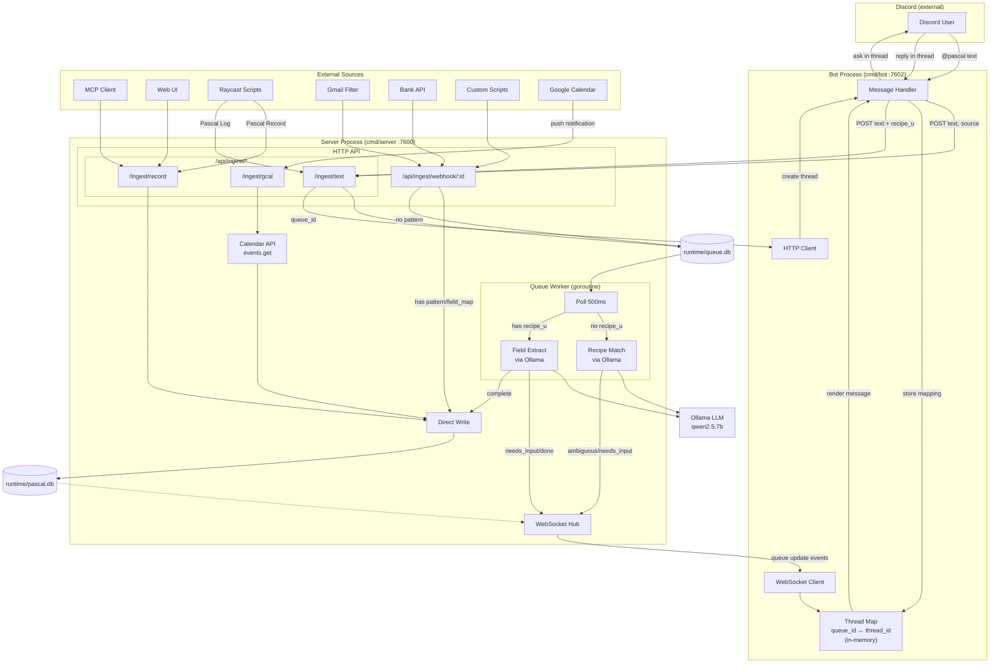
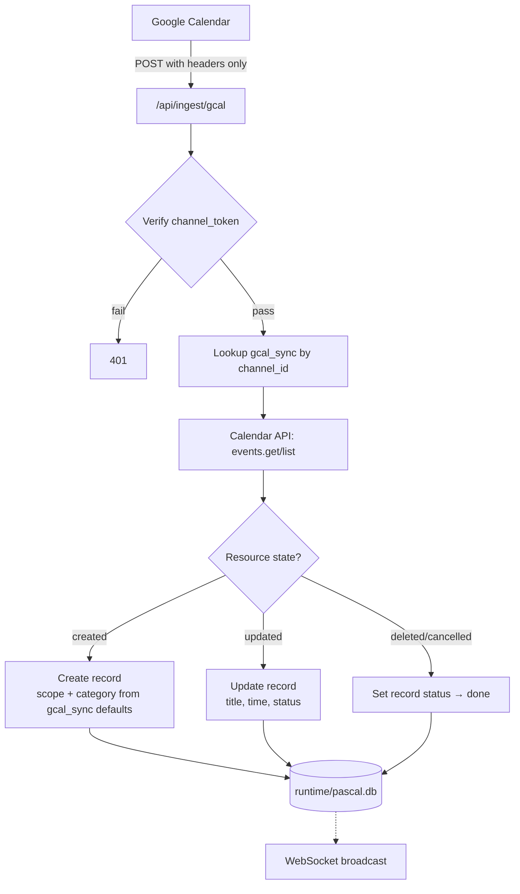
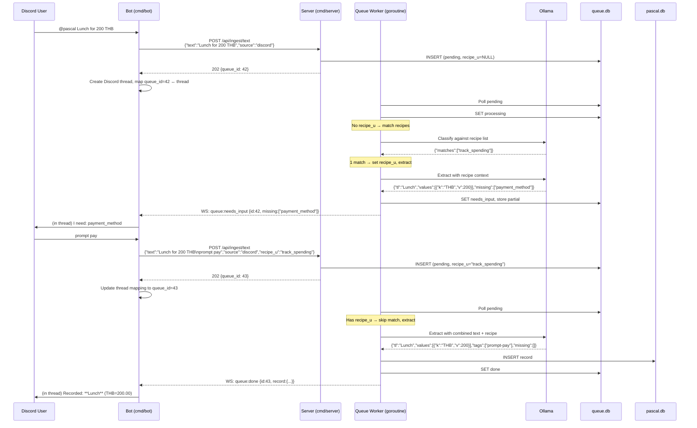

# PASCAL — Ingestion Design

Three ingestion paths into `runtime/pascal.db`. Each optimized for different source types.

## Overview



## Path 1: Structured Record

Direct record creation with validated fields.

**Endpoint:** `POST /api/ingest/record` (also available at `POST /api/records`)

**Used by:** MCP interface, Web UI, bot (after queue completes extraction)

**Flow:** Validate → generate UUIDv7 → insert record + tags + values → record_log → WS broadcast

**Response:** `201` with created record.

No queue, no inference. Caller provides complete structured data.

## Path 2: Generic Webhook

Configurable endpoints for external data sources.

**Endpoint:** `POST /api/ingest/webhook/:id`

**Network:** Public (VPS)

**Auth:** `X-Webhook-Secret` header matched against `webhook.secret`

### Schema

```sql
CREATE TABLE webhook (
    id TEXT PRIMARY KEY,              -- slug for URL path
    d TEXT NOT NULL,                   -- description
    secret TEXT NOT NULL,              -- per-webhook auth token
    pattern TEXT,                      -- regex with named groups (for text payloads)
    field_map TEXT,                    -- JSON: maps JSONPath to record fields (for JSON payloads)
    recipe_u TEXT REFERENCES recipe(u), -- optional recipe binding
    active INTEGER NOT NULL DEFAULT 1
);
```

### Three Processing Modes

#### A. Text + Pattern (regex extraction)

For patterned text payloads (email subjects, SMS, plain alerts).

**Request:**
```json
{ "text": "Purchase 450.00 THB at 7-Eleven" }
```

**Pattern:** Go regex with named groups. Named groups map to record fields:

| Named Group | Maps To |
|---|---|
| `(?P<title>...)` | `record.tl` |
| `(?P<detail>...)` | `record.dt` |
| `(?P<scope>...)` | `record.sc` |
| `(?P<category>...)` | `record.cg` |
| Any other name | Matched against `recipe_values.master_key` for numeric values |

**Example webhook:**
```
id:        "cc_kbank"
d:         "KBank credit card transaction"
secret:    "random-token"
pattern:   "(?P<title>.+?) (?P<amount>[\\d,.]+) THB"
recipe_u:  "cc_spend"
```

**Response:** `201` (direct write)

**Pattern match failure:** `422` — deterministic path stays deterministic. Fix pattern, don't fall back to LLM.

#### B. JSON + Field Map (structured extraction)

For JSON payloads from APIs (bank open API, IoT, health trackers).

**Request:**
```json
{
    "transaction": {
        "description": "7-Eleven",
        "amount": 450.00,
        "category": "food"
    }
}
```

**Field map format:**
```json
{
    "tl": "$.transaction.description",
    "cg": "$.transaction.category",
    "values": {
        "THB": "$.transaction.amount"
    }
}
```

Maps JSONPath expressions to record fields. Recipe binding fills in defaults (scope, required tags).

**Response:** `201` (direct write)

#### C. No Pattern, No Field Map (Ollama fallback)

Raw text → queue → Ollama inference.

**Request:**
```json
{ "text": "spent 200 baht on lunch at MK" }
```

If recipe bound: include recipe context (description, required values/tags) in Ollama prompt for better inference.

**Response:** `202` (queued)

### Summary

| Pattern | Field Map | Recipe | Behavior | Response |
|---|---|---|---|---|
| Yes | — | Optional | Regex extract → direct write | 201 |
| — | Yes | Optional | JSONPath extract → direct write | 201 |
| No | No | Yes | Queue to Ollama with recipe hint | 202 |
| No | No | No | Queue to Ollama, plain | 202 |

## Path 3: Google Calendar Sync

Separate from generic webhooks. Google Calendar push notifications are *sync triggers*, not data delivery — payload is nearly empty, you must fetch event details via API callback.

**Network:** Push endpoint public (VPS), setup/management endpoints Tailscale only.

**Auth:** OAuth2 for Calendar API access. Channel token for push verification.

### Schema

```sql
CREATE TABLE gcal_sync (
    id TEXT PRIMARY KEY,
    calendar_id TEXT NOT NULL,          -- Google Calendar ID
    channel_id TEXT,                    -- watch channel ID (set after watch setup)
    channel_token TEXT,                 -- verification token
    resource_id TEXT,                   -- Google resource ID
    expiration TEXT,                    -- watch expiration (needs periodic renewal)
    scope TEXT NOT NULL,                -- default scope for synced records
    category TEXT NOT NULL,             -- default category
    recipe_u TEXT REFERENCES recipe(u),
    active INTEGER NOT NULL DEFAULT 1
);
```

### Endpoints

| Method | Path | Network | Purpose |
|---|---|---|---|
| POST | `/api/ingest/gcal` | Public | Receive push notification from Google |
| POST | `/api/gcal/setup` | Tailscale | Register watch channel on a calendar |
| GET | `/api/gcal/sync/:id` | Tailscale | Manual trigger full sync |

### Push Flow



### Push Notification Headers

Google sends these headers (no meaningful body):

| Header | Purpose |
|---|---|
| `X-Goog-Channel-ID` | Channel ID (matches `gcal_sync.channel_id`) |
| `X-Goog-Resource-ID` | Resource being watched |
| `X-Goog-Resource-State` | `sync`, `exists`, or `not_exists` |
| `X-Goog-Channel-Token` | Verification token |

### Watch Renewal

Google Calendar watch channels expire (~7 days). Server needs periodic renewal:
- Goroutine checks `gcal_sync.expiration` daily
- Re-registers watch before expiry
- Updates `channel_id`, `resource_id`, `expiration`

### Calendar Event → Record Mapping

| Calendar Event Field | Record Field |
|---|---|
| `summary` | `record.tl` |
| `description` | `record.dt` |
| `start.dateTime` | `record.ct` |
| Event status `confirmed` | `record.st = 1` (todo) |
| Event status `cancelled` | `record.st = 3` (done) |
| Scope, category | From `gcal_sync` defaults |
| Recurring event | Each occurrence → separate record |

### vs Generic Webhook

| | Generic Webhook | Google Calendar Push |
|---|---|---|
| Data in payload | Yes | No (headers only) |
| Needs API callback | No | Yes (fetch event) |
| Auth | Shared secret | Channel token + OAuth2 |
| Watch expiration | N/A | ~7 days, needs renewal |
| OAuth | No | Yes |

## Unstructured Ingestion Queue

Shared by Discord bot (`/api/ingest/text`), and pattern-less webhooks. The queue is the central orchestrator for all unstructured text — it handles recipe matching, field extraction, and communicates back to callers via WebSocket.

### Queue Schema (runtime/queue.db — separate file)

```sql
CREATE TABLE ingest_queue (
    id INTEGER PRIMARY KEY AUTOINCREMENT,
    payload TEXT NOT NULL,
    source TEXT NOT NULL,              -- 'discord', 'webhook:cc_kbank', 'api', etc.
    recipe_u TEXT,                     -- resolved recipe (NULL = needs matching, set = skip to extract)
    result TEXT,                       -- JSON: worker output (extracted fields, matched recipes, error detail)
    status TEXT NOT NULL DEFAULT 'pending',
    attempts INTEGER NOT NULL DEFAULT 0,
    error TEXT,
    created_at TEXT NOT NULL DEFAULT (datetime('now')),
    processed_at TEXT
);

CREATE INDEX idx_queue_status ON ingest_queue(status, created_at);
```

### Ingest API

**Endpoint:** `POST /api/ingest/text`

```json
{
    "text": "Lunch for 200 THB using prompt pay",
    "source": "discord",
    "recipe_u": null
}
```

- `recipe_u` optional. If set, worker skips recipe matching and goes straight to extraction.
- Returns `202` with `{"queue_id": 42}`.
- Caller (e.g. bot) uses `queue_id` to track progress via WebSocket.

### Worker Logic

Single goroutine, polls every 500ms.

```
pick next pending item from queue

if recipe_u is NULL:
    → match text against all recipes via Ollama
    → 0 matches: mark failed, push WS event {type: "queue:no_match", id}
    → 1 match:  set recipe_u on item, fall through to extract
    → N matches: set status "ambiguous", store matches in result,
                 push WS event {type: "queue:ambiguous", id, matches}
                 (wait for caller to re-queue with chosen recipe_u)

if recipe_u is set:
    → extract fields via Ollama with full recipe context
      (recipe description, required values/scopes, available tags/scopes/master_values)
    → all required fields present:
        create record via direct write, mark done,
        push WS event {type: "queue:done", id, record}
    → missing required fields:
        set status "needs_input", store partial extraction in result,
        push WS event {type: "queue:needs_input", id, missing, partial}
        (wait for caller to re-queue with combined text + recipe_u)
```

### Queue Statuses

| Status | Meaning | Next action |
|---|---|---|
| `pending` | Waiting for worker | Worker picks up |
| `processing` | Worker is handling | — |
| `ambiguous` | Multiple recipe matches | Caller re-queues with chosen `recipe_u` |
| `needs_input` | Missing required fields | Caller re-queues with additional text + `recipe_u` |
| `done` | Record created | Terminal |
| `failed` | Unrecoverable error (3 retries or no match) | Terminal |

### WebSocket Events

Worker pushes queue status updates through the existing WebSocket hub. Events:

| Event type | Payload | Meaning |
|---|---|---|
| `queue:ambiguous` | `{id, matches: ["recipe_a", "recipe_b"]}` | Multiple recipes matched, pick one |
| `queue:needs_input` | `{id, missing: ["field"], partial: {...}}` | Extraction incomplete, need more info |
| `queue:done` | `{id, record: {...}}` | Record created successfully |
| `queue:no_match` | `{id}` | No recipe matched |
| `queue:failed` | `{id, error: "..."}` | Processing failed |

### Worker Rules

- Single goroutine, polls every 500ms
- Backpressure: reject `429` if pending count > 1000
- 3 retry attempts for transient errors (Ollama timeout, etc.), then mark `failed`
- `ambiguous` and `needs_input` are NOT retried — they wait for caller input
- Separate DB file (`runtime/queue.db`): ephemeral, no WAL contention with main DB, `rm runtime/queue.db` to reset

### Ollama Prompt Strategy

**Recipe matching** (no `recipe_u`):
```
You are a classifier. Given user text and available recipes, return which recipe(s) match.

Available recipes:
- track_spending: Track daily expenses with amount and payment method
- meal_log: Log meals with calories and ingredients
...

Return JSON: {"matches": ["recipe_usecase"]}
Return empty matches if none fit.

User text: {payload}
```

**Field extraction** (with `recipe_u`):
```
Extract structured data from user text using the recipe context below.

Recipe: track_spending — Track daily expenses with amount and payment method

Expected values:
- THB (REQUIRED)
- payment_method

Available tags: food, transport, entertainment, ...
Available scopes: Personal, Personal|Finance, Work, ...

Return JSON with fields: tl, dt, st, sc, tags, values, missing
"missing" = list of REQUIRED fields not found in the text.

User text: {payload}
```

## Discord Bot — Queue-Driven Conversation

The Discord bot uses the queue as the processing backbone. Bot is thin: it posts to the queue, listens for WebSocket updates, and renders Discord messages. All inference happens in the server's queue worker.

### Process Responsibilities

| Process | Role |
|---|---|
| **Bot** (`cmd/bot`) | Discord I/O, thread management, queue_id↔thread_id mapping, renders WS events as Discord messages |
| **Server** (`cmd/server`) | Queue management, recipe matching (Ollama), field extraction (Ollama), record creation, pushes WS events |
| **Ollama** | LLM inference (called by server worker only) |

### Flow



### Bot State (in-memory)

Bot maintains a lightweight map, not conversation state:

| Map | Key → Value | Purpose |
|---|---|---|
| `threadMap` | `queue_id` → `discord_thread_id` | Route WS events to correct Discord thread |
| `userThreads` | `channelID:userID` → `thread_id` | Track active thread per user for follow-up routing |

No conversation phase tracking. The queue status IS the state. Bot just renders what the server tells it.

### Bot Behavior

1. **New `@pascal` message:** POST to `/api/ingest/text`, create Discord thread, store mapping
2. **WS `queue:ambiguous`:** Post recipe choices in thread, wait for reply
3. **WS `queue:needs_input`:** Post missing field list in thread, wait for reply
4. **WS `queue:done`:** Post confirmation in thread
5. **WS `queue:no_match` / `queue:failed`:** Post error in thread
6. **User reply in thread:** Look up thread → last queue context, POST new `/api/ingest/text` with combined text + resolved `recipe_u`
7. **`cancel`:** Close thread context, no further processing

## Raycast Scripts

Lightweight ingestion from macOS/iPhone via Raycast. Scripts in `scripts/`.

### `raycast-pascal-log.sh` — Unstructured

Quick-capture text → queue → Ollama processing.

- **Raycast command:** "Pascal Log"
- **Input:** Free text (e.g. "Lunch 200 THB prompt pay")
- **Endpoint:** `POST /api/ingest/text` with `source: "raycast"`
- **Response:** "Queued (#N)"

### `raycast-pascal-record.sh` — Structured

Direct record creation, no Ollama.

- **Raycast command:** "Pascal Record"
- **Input:** Title + optional scope
- **Endpoint:** `POST /api/ingest/record`
- **Response:** "Recorded: {title}"

### Setup

Set `PASCAL_URL` env var in Raycast preferences. Default: `http://100.64.0.1:7600` (Tailscale IP of server).

## Network Topology

```
Internet (Public VPS IP)
├── POST /api/ingest/webhook/:id       ← Gmail, bank, external services
├── POST /api/ingest/gcal       ← Google Calendar push notifications
├── POST /api/ingest/record     ← (public alias for structured ingestion)
│
Tailscale (Internal)
├── POST /api/ingest/text       ← Discord bot, Raycast (Pascal Log)
├── POST /api/ingest/record     ← MCP, Web UI, Raycast (Pascal Record)
├── POST /api/records           ← MCP, Web UI (original path, kept)
├── GET  /api/records           ← Web UI
├── GET  /api/stats             ← Web UI
├── POST /api/gcal/setup        ← Admin
├── GET  /api/gcal/sync/:id     ← Admin
├── WS   /ws                    ← Web UI, Bot
└── GET  /                      ← Web dashboard
```
