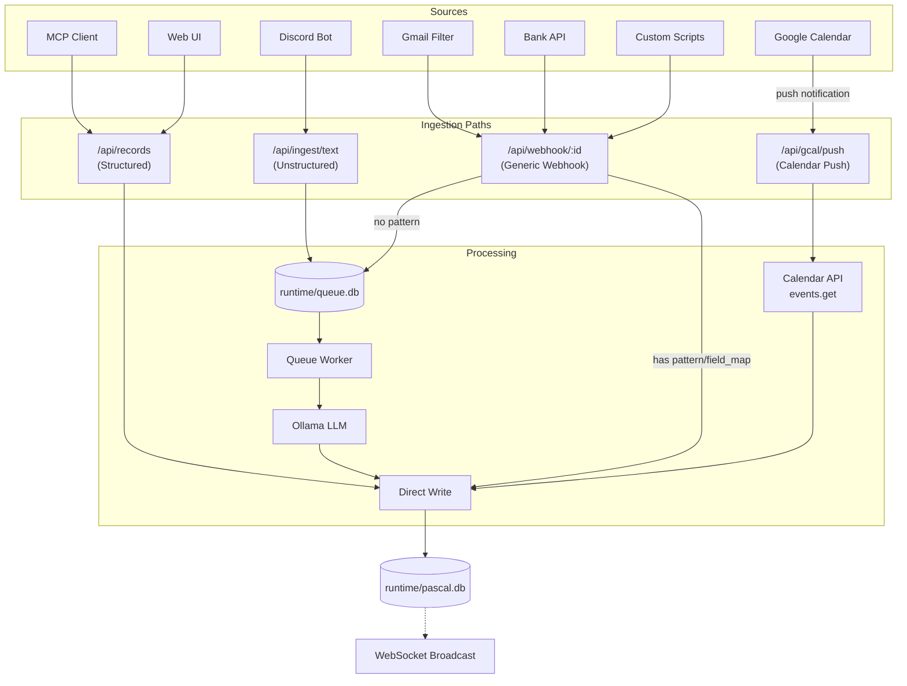
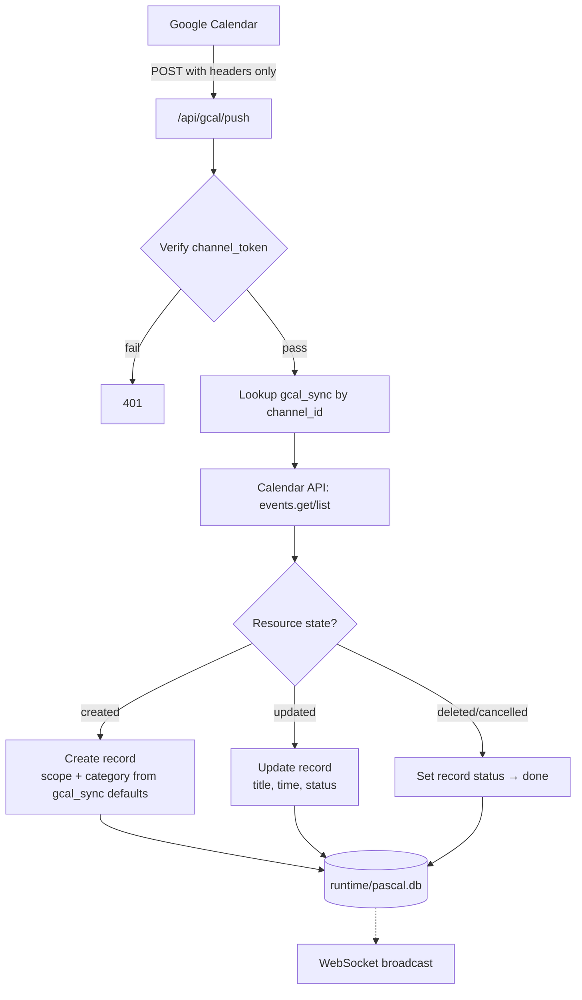

# PASCAL — Ingestion Design

Three ingestion paths into `runtime/pascal.db`. Each optimized for different source types.

## Overview



## Path 1: Structured API

Direct record creation with validated fields.

**Endpoint:** `POST /api/records`

**Used by:** MCP interface, Web UI

**Flow:** Validate → generate UUIDv7 → insert record + tags + values → record_log → WS broadcast

**Response:** `201` with created record.

No queue, no inference. Caller provides complete structured data.

## Path 2: Generic Webhook

Configurable endpoints for external data sources.

**Endpoint:** `POST /api/webhook/:id`

**Network:** Public (VPS)

**Auth:** `X-Webhook-Secret` header matched against `webhook.secret`

### Schema

```sql
CREATE TABLE webhook (
    id TEXT PRIMARY KEY,              -- slug for URL path
    d TEXT NOT NULL,                   -- description
    secret TEXT NOT NULL,              -- per-webhook auth token
    pattern TEXT,                      -- regex with named groups (for text payloads)
    field_map TEXT,                    -- JSON: maps JSONPath to record fields (for JSON payloads)
    recipe_u TEXT REFERENCES recipe(u), -- optional recipe binding
    active INTEGER NOT NULL DEFAULT 1
);
```

### Three Processing Modes

#### A. Text + Pattern (regex extraction)

For patterned text payloads (email subjects, SMS, plain alerts).

**Request:**
```json
{ "text": "Purchase 450.00 THB at 7-Eleven" }
```

**Pattern:** Go regex with named groups. Named groups map to record fields:

| Named Group | Maps To |
|---|---|
| `(?P<title>...)` | `record.tl` |
| `(?P<detail>...)` | `record.dt` |
| `(?P<scope>...)` | `record.sc` |
| `(?P<category>...)` | `record.cg` |
| Any other name | Matched against `recipe_values.master_key` for numeric values |

**Example webhook:**
```
id:        "cc_kbank"
d:         "KBank credit card transaction"
secret:    "random-token"
pattern:   "(?P<title>.+?) (?P<amount>[\\d,.]+) THB"
recipe_u:  "cc_spend"
```

**Response:** `201` (direct write)

**Pattern match failure:** `422` — deterministic path stays deterministic. Fix pattern, don't fall back to LLM.

#### B. JSON + Field Map (structured extraction)

For JSON payloads from APIs (bank open API, IoT, health trackers).

**Request:**
```json
{
    "transaction": {
        "description": "7-Eleven",
        "amount": 450.00,
        "category": "food"
    }
}
```

**Field map format:**
```json
{
    "tl": "$.transaction.description",
    "cg": "$.transaction.category",
    "values": {
        "THB": "$.transaction.amount"
    }
}
```

Maps JSONPath expressions to record fields. Recipe binding fills in defaults (scope, required tags).

**Response:** `201` (direct write)

#### C. No Pattern, No Field Map (Ollama fallback)

Raw text → queue → Ollama inference.

**Request:**
```json
{ "text": "spent 200 baht on lunch at MK" }
```

If recipe bound: include recipe context (description, required values/tags) in Ollama prompt for better inference.

**Response:** `202` (queued)

### Summary

| Pattern | Field Map | Recipe | Behavior | Response |
|---|---|---|---|---|
| Yes | — | Optional | Regex extract → direct write | 201 |
| — | Yes | Optional | JSONPath extract → direct write | 201 |
| No | No | Yes | Queue to Ollama with recipe hint | 202 |
| No | No | No | Queue to Ollama, plain | 202 |

## Path 3: Google Calendar Sync

Separate from generic webhooks. Google Calendar push notifications are *sync triggers*, not data delivery — payload is nearly empty, you must fetch event details via API callback.

**Network:** Push endpoint public (VPS), setup/management endpoints Tailscale only.

**Auth:** OAuth2 for Calendar API access. Channel token for push verification.

### Schema

```sql
CREATE TABLE gcal_sync (
    id TEXT PRIMARY KEY,
    calendar_id TEXT NOT NULL,          -- Google Calendar ID
    channel_id TEXT,                    -- watch channel ID (set after watch setup)
    channel_token TEXT,                 -- verification token
    resource_id TEXT,                   -- Google resource ID
    expiration TEXT,                    -- watch expiration (needs periodic renewal)
    scope TEXT NOT NULL,                -- default scope for synced records
    category TEXT NOT NULL,             -- default category
    recipe_u TEXT REFERENCES recipe(u),
    active INTEGER NOT NULL DEFAULT 1
);
```

### Endpoints

| Method | Path | Network | Purpose |
|---|---|---|---|
| POST | `/api/gcal/push` | Public | Receive push notification from Google |
| POST | `/api/gcal/setup` | Tailscale | Register watch channel on a calendar |
| GET | `/api/gcal/sync/:id` | Tailscale | Manual trigger full sync |

### Push Flow



### Push Notification Headers

Google sends these headers (no meaningful body):

| Header | Purpose |
|---|---|
| `X-Goog-Channel-ID` | Channel ID (matches `gcal_sync.channel_id`) |
| `X-Goog-Resource-ID` | Resource being watched |
| `X-Goog-Resource-State` | `sync`, `exists`, or `not_exists` |
| `X-Goog-Channel-Token` | Verification token |

### Watch Renewal

Google Calendar watch channels expire (~7 days). Server needs periodic renewal:
- Goroutine checks `gcal_sync.expiration` daily
- Re-registers watch before expiry
- Updates `channel_id`, `resource_id`, `expiration`

### Calendar Event → Record Mapping

| Calendar Event Field | Record Field |
|---|---|
| `summary` | `record.tl` |
| `description` | `record.dt` |
| `start.dateTime` | `record.ct` |
| Event status `confirmed` | `record.st = 1` (todo) |
| Event status `cancelled` | `record.st = 3` (done) |
| Scope, category | From `gcal_sync` defaults |
| Recurring event | Each occurrence → separate record |

### vs Generic Webhook

| | Generic Webhook | Google Calendar Push |
|---|---|---|
| Data in payload | Yes | No (headers only) |
| Needs API callback | No | Yes (fetch event) |
| Auth | Shared secret | Channel token + OAuth2 |
| Watch expiration | N/A | ~7 days, needs renewal |
| OAuth | No | Yes |

## Unstructured Ingestion Queue

Shared by unstructured API (`/api/ingest/text`) and pattern-less webhooks.

### Queue Schema (runtime/queue.db — separate file)

```sql
CREATE TABLE ingest_queue (
    id INTEGER PRIMARY KEY AUTOINCREMENT,
    payload TEXT NOT NULL,
    source TEXT NOT NULL,              -- 'discord', 'webhook:cc_kbank', 'api', etc.
    recipe_hint TEXT,                  -- optional recipe_u for Ollama context
    status TEXT NOT NULL DEFAULT 'pending',
    attempts INTEGER NOT NULL DEFAULT 0,
    error TEXT,
    created_at TEXT NOT NULL DEFAULT (datetime('now')),
    processed_at TEXT
);

CREATE INDEX idx_queue_status ON ingest_queue(status, created_at);
```

### Worker Rules

- Single goroutine, polls every 500ms
- Backpressure: reject `429` if pending count > 1000
- 3 retry attempts, then mark `failed` (dead letter)
- Idempotent writes via UUIDv7 check (crash recovery)
- If `recipe_hint` set: include recipe description + required values/tags in Ollama prompt
- Separate DB file (`runtime/queue.db`): ephemeral, no WAL contention with main DB, `rm runtime/queue.db` to reset

### Ollama Prompt Strategy

Without recipe hint:
```
Parse this text into a structured record: {payload}
Return JSON with fields: tl, dt, st, sc, cg, tags, values
```

With recipe hint:
```
Parse this text into a structured record for use case "{recipe.d}".
Required values: {recipe_values list}
Required tags: {recipe_tags list}
Text: {payload}
Return JSON with fields: tl, dt, st, sc, cg, tags, values
```

Recipe context significantly improves extraction accuracy for known use cases.

## Network Topology

```
Internet (Public VPS IP)
├── POST /api/webhook/:id     ← Gmail, bank, external services
├── POST /api/gcal/push       ← Google Calendar push notifications
│
Tailscale (Internal)
├── POST /api/records         ← MCP, Web UI
├── GET  /api/records         ← Web UI
├── GET  /api/stats           ← Web UI
├── POST /api/ingest/text     ← Discord bot
├── POST /api/gcal/setup      ← Admin
├── GET  /api/gcal/sync/:id   ← Admin
├── WS   /ws                  ← Web UI
└── GET  /                    ← Web dashboard
```
